# Pwn4C

[](https://github.com/3lyly0/Pwn4C/actions/workflows/cli.yml)
[](https://github.com/3lyly0/Pwn4C/actions/workflows/daemon.yml)
[](https://github.com/3lyly0/Pwn4C/actions/workflows/firmware.yml)
[](https://github.com/3lyly0/Pwn4C/actions/workflows/release.yml)



Pwn4C converts a stock Xiaomi Mi Router 4C (MediaTek MT7628N, ~$15 USD) into a headless Wi-Fi penetration testing implant. It exploits CVE-2019-18370/18371 to silently deploy a custom OpenWrt firmware (<4MB) over the LAN in under 90 seconds, turning the router into a remote RF drone controlled from a host PC over Ethernet.

<br clear="left"/>

---

## Features

- **Zero-Touch Air-Gapped Deployment (`pwn4c infect`)**: Exploits stock firmware Web API authentication & command injection to enable root access and optionally flash custom OpenWrt firmware (`--flash`) over LAN with zero internet, serial, or TFTP intervention. BusyBox is embedded in the uploaded payload, so the router needs no internet access and the host needs no inbound callback port for the root-shell stage.
- **Dual-Port Architecture & HMAC-SHA256 Security**: Dedicated TCP control channel (port 4444) with optional pre-shared key (`--psk`) challenge-response authentication carries structured JSON telemetry and commands; high-throughput UDP channel (port 5555) streams raw 802.11 frames (RadioTap/PCAP) with 48-bit monotonic timestamps and indexed fragment reassembly.
- **Zero-Conf Autodiscovery (`pwn4c discover`)**: Drone implants respond to discovery beacons over UDP 4440; host CLI automatically detects all reachable drones on the subnet without manual IP configuration.
- **Autonomous Daemon-Side Channel Hopping (`pwn4c hop` / `pwn4c monitor --hop`)**: Sweeps across 2.4 GHz channels (1–13) directly inside the C daemon's `select()` timer loop using native `nl80211` Generic Netlink (`<2ms` switch latency) with zero TCP polling overhead.
- **Kernel Classic BPF Frame Filtering (`--mgmt-only`, `--filter-bssid`)**: Attaches classic BPF bytecode (`SO_ATTACH_FILTER`) to the `AF_PACKET` socket in kernel space, filtering Management frames or target BSSIDs across Addr1/Addr2/Addr3 (preserving Data and WPA/EAPOL handshakes).
- **Live Wireshark Pipe Streaming (`pwn4c monitor -o -`)**: Streams standard `DLT_IEEE802_11_RADIO` PCAP records directly to `stdout` for real-time inspection in Wireshark (`pwn4c monitor -c 6 -o - | wireshark -k -i -`).
- **Active 802.11 Frame Injection & Deauth (`pwn4c deauth`)**: Enqueues raw 802.11 management frames into a 64-slot non-blocking TX ring buffer with configurable inter-frame pacing (`--interval`).
- **Hardware-Level RF Control & Self-Healing (`pwn4c config`, `pwn4c status`)**: Direct `nl80211` and POSIX `ioctl` control over transmission power (1–20 dBm), dynamic MAC spoofing/randomization, automatic interface recovery on `ENETDOWN`/`ENODEV`, and full drop telemetry (`rx_frames`, `tx_frames`, `ring_overruns`, `kernel_drops`, `iface_recoveries`).

---

## CLI Reference

| Command | Syntax / Example | Description |
|---|---|---|
| `infect` | `pwn4c infect 192.168.31.1 [-f sysupgrade.bin]` | Exploits stock Xiaomi firmware (air-gapped) and optionally flashes Pwn4C OS |
| `discover` | `pwn4c discover [-t 3]` | Scans subnet for active Pwn4C drone implants via UDP broadcast |
| `status` | `pwn4c status [target_ip] [--psk secret]` | Queries live telemetry, drop counters, and radio state over TCP |
| `monitor` | `pwn4c monitor [target_ip] -c 6 -o capture.pcap [--hop]` | Starts 802.11 monitor mode, optional BPF filter/hopper, and streams PCAP |
| `hop` | `pwn4c hop [target_ip] -d 250 -c 1,6,11` | Starts autonomous drone-side channel hopping across specified channels |
| `deauth` | `pwn4c deauth [target_ip] -b <bssid> [-c <client>]` | Injects raw IEEE 802.11 deauthentication frames via non-blocking TX queue |
| `config` | `pwn4c config [target_ip] --power 20 --mac random` | Adjusts TX power, randomizes/spoofs MAC, or restores normal mode |

---

## Quick Start

### 1. Build the Host CLI

```bash
git clone https://github.com/3lyly0/Pwn4C.git
cd Pwn4C
go build -ldflags="-s -w" -o pwn4c ./cmd/pwn4c
sudo cp pwn4c /usr/local/bin/   # On Linux/macOS
```

*(Pre-compiled binaries for Linux, macOS, and Windows are also available in [Releases](https://github.com/3lyly0/Pwn4C/releases).)*

### 2. Infect Stock Router

Connect your host PC to the router's LAN port:

```bash
pwn4c infect 192.168.31.1
# Or infect and automatically flash Pwn4C OpenWrt image:
pwn4c infect 192.168.31.1 --flash firmware/output/pwn4c-firmware-mi4c-sysupgrade.bin
```

The payload tarball contains a vendored `busybox-mipsel` binary, so the router
does not need internet access and the host does not need an inbound firewall
rule for the telnet/SSH stage. `--flash` additionally starts a temporary local
TCP server to deliver the sysupgrade image. See
[installation.md](docs/installation.md#a2-run-the-infect-command) for details.

### 3. Discover Active Drone

Once the custom firmware is booted, discover the implant on the link:

```bash
pwn4c discover
```

### 4. Monitor, Filter & Pipe Live Traffic to Wireshark

```bash
# Save channel 6 capture to file with BSSID kernel BPF filter
pwn4c monitor -c 6 --filter-bssid AA:BB:CC:DD:EE:FF -o capture.pcap

# Sweep channels 1, 6, 11 autonomously and pipe live to Wireshark
pwn4c monitor --hop --channels 1,6,11 --dwell 250 -o - | wireshark -k -i -
```

### 5. RF Attacks & Hardware Configuration

```bash
# Inject 20 deauth frames against target AP client with 10ms pacing
pwn4c deauth -b AA:BB:CC:DD:EE:FF -c 11:22:33:44:55:66 -i 6 -n 20 --interval 10

# Maximize TX power and randomize drone MAC
pwn4c config --power 20 --mac random
```

---

## Documentation

- [Architecture](docs/architecture.md): System diagram, Drone/Host roles, transport spec, infection lifecycle.
- [Hardware Reference](docs/hardware.md): MT7628N specs, flash layout, RF constraints, storage budget.
- [Installation Guide](docs/installation.md): Automated (Path A) and manual (Path B) deployment instructions.
- [API Reference](docs/api_reference.md): Wire protocol, TCP JSON commands, UDP stream format, error codes.
- [Troubleshooting](docs/troubleshooting.md): Discovery failures, exploit issues, dropped frames, firmware recovery.

---

## Repository Structure

```
Pwn4C/
├── .github/workflows/  # Modular CI/CD pipelines (CLI, Daemon, Firmware, Release)
├── cmd/pwn4c/          # Host Controller (Go CLI): C2, autodiscovery, exploit deployer
├── daemon/             # pwn4cd (C99): embedded daemon for Drone (mipsel_24kc, musl, static)
├── firmware/           # OpenWrt ImageBuilder scripts, Dockerized build, rootfs config
├── internal/
│   ├── drone/          # C2 TCP client, UDP PCAP receiver, 802.11 frame builders
│   └── exploit/        # CVE-2019-18370/18371 air-gapped exploit & flash engine
├── docs/               # Architecture, API wire specs, and hardware documentation
└── LICENSE             # Dual-license specification
```

---

## Disclaimer

This software is provided strictly for **educational purposes** and **authorized security auditing**. Unauthorized access to computer networks is illegal under the Computer Fraud and Abuse Act (18 U.S.C. 1030), the Computer Misuse Act 1990, and equivalent legislation in most jurisdictions. You are solely responsible for ensuring you have explicit, written authorization before using this tool against any network or device. The authors assume no liability for misuse.

---

## License

This project uses a dual-license model:

| Component | License |
|-----------|---------|
| Firmware and Daemon (`daemon/`, `firmware/`) | [GNU General Public License v3.0](LICENSE) |
| Host Client (`cmd/pwn4c/`, `internal/`) | MIT License |
